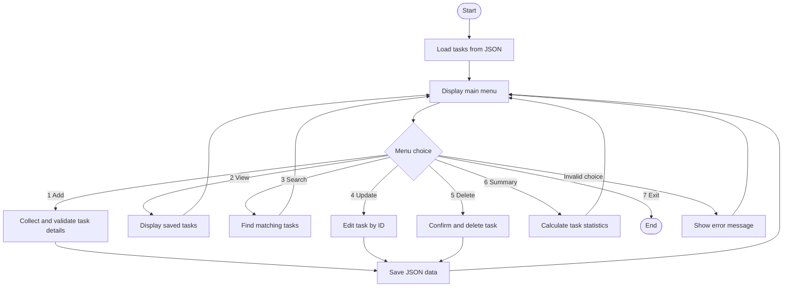

# StudyTrack — Application Wireframe

## 1. Main Menu

```text
+------------------------------------------------+
|                   STUDYTRACK                   |
|        Student Task and Deadline Tracker       |
+------------------------------------------------+
|  1. Add a task                                  |
|  2. View all tasks                              |
|  3. Search tasks                                |
|  4. Update a task                               |
|  5. Delete a task                               |
|  6. View task summary                           |
|  7. Exit                                        |
+------------------------------------------------+
|  Choose an option (1-7): _                      |
+------------------------------------------------+
```

## 2. Add Task Screen

```text
+---------------------- ADD TASK -----------------+
| Task title:         _________________________   |
| Subject:            _________________________   |
| Date assigned:      YYYY-MM-DD                  |
| Due date:           YYYY-MM-DD                  |
| Priority:           Low / Medium / High         |
| Status:             Pending / In Progress /     |
|                     Completed                   |
| Estimated minutes:  _________________________   |
+------------------------------------------------+
| Message: Task saved successfully.               |
+------------------------------------------------+
```

## 3. Task List Screen

```text
+---------------------- TASKS --------------------+
| ID  TITLE                 SUBJECT     DUE DATE  |
| 1   Science worksheet    Science     2026-11-24|
| 2   Math exercises       Mathematics 2026-11-25|
+------------------------------------------------+
```

## 4. Summary Screen

```text
+-------------------- TASK SUMMARY ---------------+
| Total tasks:                 6                  |
| Pending:                     2                  |
| In Progress:                 2                  |
| Completed:                   2                  |
| Completion rate:            33.3%               |
| Upcoming tasks:              3                  |
| Overdue tasks:               1                  |
| Average estimated time:     40.0 minutes        |
|                                                |
| Tasks by subject:                               |
| Science: 2     Mathematics: 2     English: 2    |
+------------------------------------------------+
```

*All numbers in the summary screen are examples. Actual output depends on the saved data.*

## 5. Program Flow


