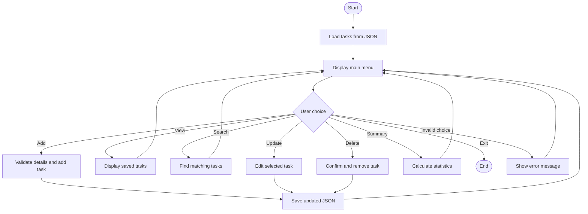

# StudyTrack — Sample Wireframe

This is a simple planning wireframe. It shows the proposed screens and how the user moves through the program. It is not the finished application design.

## 1. Main Menu

```text
+--------------------------------------------------+
|                    STUDYTRACK                    |
|           Student Task and Deadline Tracker      |
+--------------------------------------------------+
|  1. Add a task                                   |
|  2. View all tasks                               |
|  3. Search / filter tasks                        |
|  4. Update a task                                |
|  5. Delete a task                                |
|  6. View task summary                            |
|  7. Exit                                         |
+--------------------------------------------------+
|  Enter your choice: _                            |
+--------------------------------------------------+
```

## 2. Add a Task

```text
+---------------------- ADD TASK ------------------+
| Task title:       __________________________     |
| Subject:          __________________________     |
| Date assigned:    YYYY-MM-DD                     |
| Due date:         YYYY-MM-DD                     |
| Priority:         Low / Medium / High            |
| Status:           Pending / In Progress / Done   |
| Estimated minutes: ________________________      |
|                                                  |
| [Save Task]   [Cancel]                           |
+--------------------------------------------------+
| Message: Task saved successfully.                |
+--------------------------------------------------+
```

## 3. View Tasks

```text
+------------------------ TASKS -------------------+
| ID | Title             | Subject | Due Date     |
|----|-------------------|---------|--------------|
| 1  | Science worksheet | Science | 2026-11-24   |
| 2  | Math exercises    | Math    | 2026-11-25   |
| 3  | Essay draft       | English | 2026-11-27   |
+--------------------------------------------------+
| Choose a task ID to view details, or 0 to return.|
+--------------------------------------------------+
```

## 4. Task Summary

```text
+--------------------- TASK SUMMARY ---------------+
| Total tasks:                 6                   |
| Pending:                     2                   |
| In Progress:                 2                   |
| Completed:                   2                   |
| Completion rate:            33.3%                |
| Upcoming tasks:              3                   |
| Overdue tasks:               1                   |
|                                                  |
| Tasks by subject:                               |
| Science: 2     Mathematics: 2     English: 2     |
+--------------------------------------------------+
| Press Enter to return to the main menu.           |
+--------------------------------------------------+
```

*The numbers above are sample output only. Actual results will depend on the records saved by the user.*

## 5. Program Flow



## 6. User Interaction

The user starts the program and sees the main menu. They select an operation by entering its number. For actions that change data, the program validates the input and saves the updated task list to the JSON file. After displaying a result or an error message, the program returns to the main menu. The program ends only when the user selects Exit.
